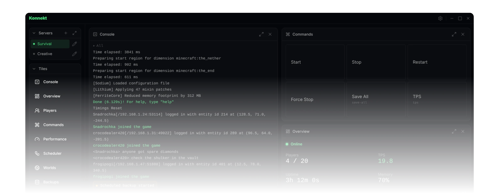

# Konnekt

A desktop dashboard for the Minecraft Java servers on your computer.

[](https://github.com/kollektiv-mc/Konnekt/actions/workflows/ci.yml)
[](https://github.com/kollektiv-mc/Konnekt/actions/workflows/codeql.yml)
[](https://scanaislop.com/kollektiv-mc/konnekt)
[](#verify-a-download)
[](https://github.com/kollektiv-mc/Konnekt/releases)
[](#platforms)
[](LICENSE)

<!-- Add once its first run has been read (.github/workflows/scorecard.yml):
[](https://scorecard.dev/viewer/?uri=github.com/kollektiv-mc/Konnekt) -->

[Download](https://konnekt.pages.dev/download) ·
[Docs](https://konnekt.pages.dev/docs) ·
[Demo](https://konnekt-demo.pages.dev/) ·
[Roadmap](https://konnekt.pages.dev/roadmap)

Konnekt is alpha.
It runs Vanilla, Paper, Spigot, Bukkit, Fabric, Forge and NeoForge servers, one at a time.

## Features

### Tile dashboard

Every part of Konnekt is a tile you drag, resize and snap to a grid.
Closed tiles wait in the crate.
Layouts save the arrangement, and four come built in.

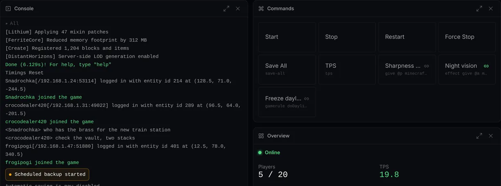

### Live console

The server log as it is written, with a prompt for commands and quick-command buttons.
Filter by kind of line, or search for a word.

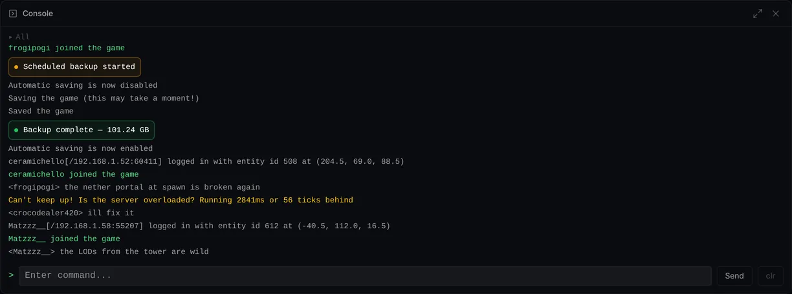

### Players

Who is online, with kick, ban and pardon.
Op, whitelist and bans for each player in one panel.

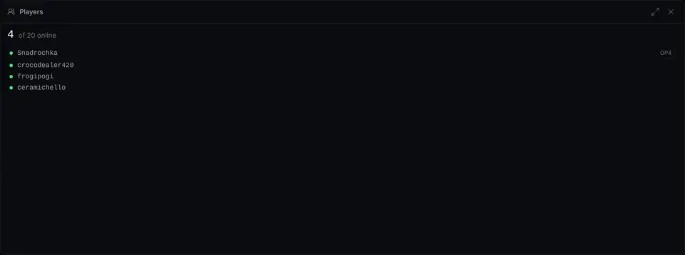

### Performance

TPS, CPU, memory and players, with an hour of history.
Nothing is installed on the server.

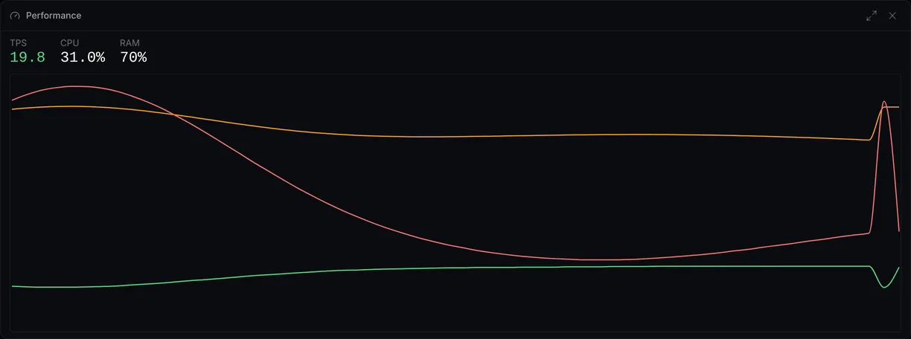

### Worlds

Each world as a planet, with its nether and end as moons, sized by disk use.
Seed, size and version come from the level data.
Switch, rename, duplicate, back up and delete worlds.

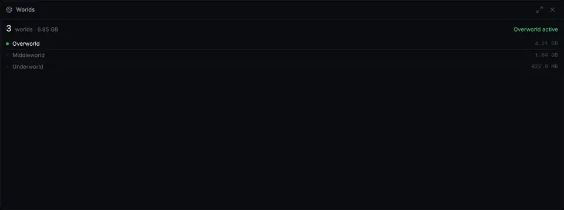

### Backups

Manual or scheduled backups of a server or a single world.
Restore with the server stopped.

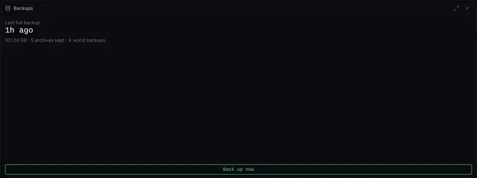

### Config editor

`server.properties` as a form, or the file itself.
Plugin and mod configs in YAML, JSON and TOML open in the same place.

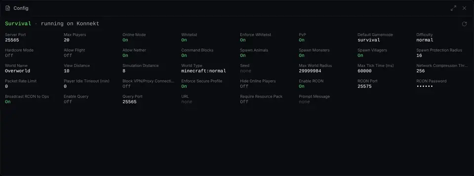

### Mods and plugins

Search Modrinth, pick a version, and Konnekt installs it with its dependencies.
Update, disable or remove what is installed, or add a jar of your own.

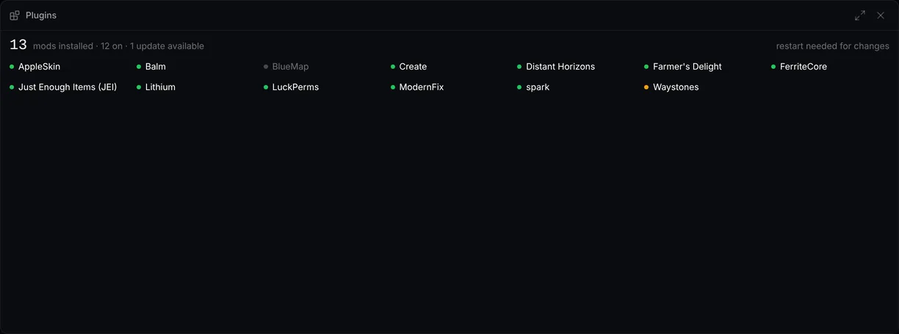

### Servers

Each server keeps its own jar, folder and JVM arguments.
The dashboard follows the server you pick.
On a first start, Konnekt offers to accept the EULA.

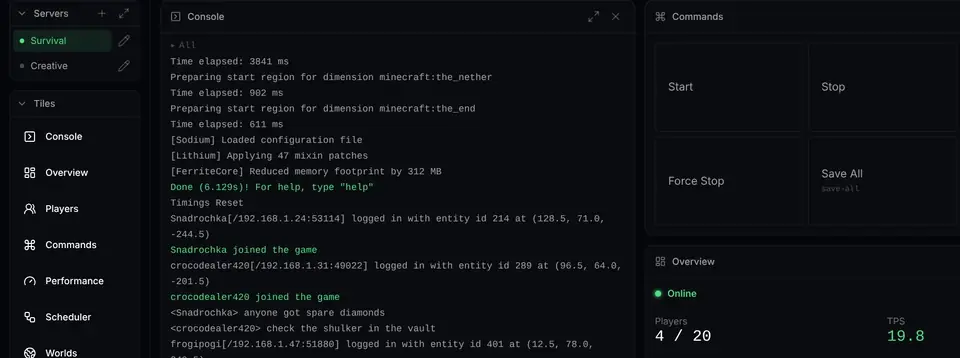

### Scheduler

A graph editor for automation.
Triggers (a schedule, a player joining, a crash, a TPS drop) start blocks that run commands, back up, wait, upload to a bucket or call a URL.
Each block has a [docs page](https://konnekt.pages.dev/docs/blocks/).

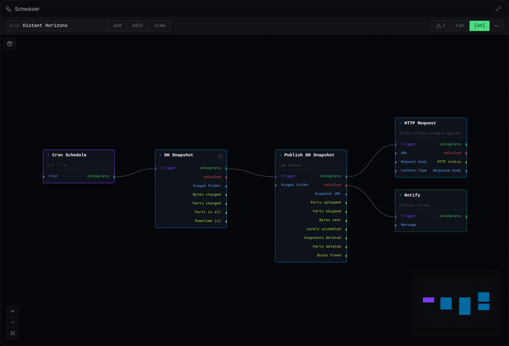

### Remote Access

The dashboard in a browser on another device, through a tunnel, behind a password and a per-device approval.
Claude Code, Claude Desktop and claude.ai can read and operate your servers through Konnekt's MCP tools.
[Remote Access docs](https://konnekt.pages.dev/docs/settings/remote-access).

### Notifications and updates

Desktop notifications and in-app bubbles for crashes, joins, backups and scheduled runs.
Konnekt updates itself on Windows and Linux, from releases or nightly snapshots.
An RPM install shows the steps to update it instead.

## Compatibility

| Name | Status | What Konnekt does |
| --- | --- | --- |
| [Distant Horizons](https://modrinth.com/mod/distanthorizons) | Compatible | Snapshots a server's LOD data and publishes it to a bucket from the scheduler. [Guide](https://konnekt.pages.dev/docs/dh-publish) |
| [playit.gg](https://playit.gg) | Planned ([#38](https://github.com/kollektiv-mc/Konnekt/issues/38)) | A public address for the server through a playit.gg tunnel |
| [Tailscale](https://tailscale.com) | Planned ([#818](https://github.com/kollektiv-mc/Konnekt/issues/818)) | To be assessed |
| [Multiverse](https://github.com/Multiverse/Multiverse-Core) | Planned | Its worlds in the Worlds tile, world connections, portals and signs |
| [BlueMap](https://bluemap.bluecolored.de) | Planned | The map in Konnekt |
| [WorldGuard](https://enginehub.org/worldguard) | Planned | Regions in Konnekt |

## Platforms

| Platform | File | Notes |
| --- | --- | --- |
| Windows | `konnekt-windows-amd64-setup.exe` | Installs for your account. Not code signed, so SmartScreen warns on first launch. |
| macOS, Apple silicon and Intel | `konnekt-darwin-universal.dmg` | Not notarised: allow it under System Settings, Privacy & Security. No self-update or tunnel yet. |
| Linux | `konnekt-linux-amd64` | Needs webkit2gtk-4.1 and gtk3: Fedora 36, Ubuntu 22.04, Debian 12, Rocky and RHEL 10, or newer. |
| Fedora, Rocky and RHEL 10 | `konnekt-<version>-1.el10.x86_64.rpm` | Rocky and RHEL 9 are not supported. |

Releases are on the [releases page](https://github.com/kollektiv-mc/Konnekt/releases).
The `snapshot` prerelease is rebuilt from `main` and is untested.
Settings, General switches the update channel.
`konnekt-windows-amd64.exe` is attached only for the in-app updater.

### Verify a download

Every file is built by GitHub Actions and carries a signed build provenance attestation.
With the [GitHub CLI](https://cli.github.com/):

```bash
gh attestation verify konnekt-windows-amd64-setup.exe --repo kollektiv-mc/Konnekt
```

Each release also ships `checksums.txt`:

```bash
sha256sum -c checksums.txt --ignore-missing
```

## Build from source

Needs [Go](https://go.dev/), [Node.js](https://nodejs.org/) with [pnpm](https://pnpm.io/), and the [Wails CLI](https://wails.io/docs/gettingstarted/installation).
On Linux, also the webkit2gtk and gtk3 development packages: `wails doctor` lists what is missing.

```bash
pnpm install
wails dev      # with hot reload
wails build    # a production binary
```

Go and Wails v2 on the backend, React 19, TypeScript, Vite, Tailwind CSS v4 and Zustand on the frontend.
[`agent_docs/CLAUDE.md`](agent_docs/CLAUDE.md) has the architecture and the checks CI runs.

## Fair warning

This is a personal side project, built to run my own Minecraft servers the way I want.
Most of the code comes from Claude, with me reading over its shoulder.
I'm not a programmer, so don't expect a textbook-clean codebase.
It works for me, and that's the bar I'm holding it to.

What runs on every change instead of my judgement:

- Typecheck, lint, formatting, both test suites, a production build, a bundle budget and a coverage floor, on Windows and Linux. Nothing merges red.
- [CodeQL](.github/workflows/codeql.yml) over the Go, TypeScript, Python and the workflows.
- A [signed build provenance attestation](#verify-a-download) on every published binary.
- [OpenSSF Scorecard](.github/workflows/scorecard.yml), published where I cannot edit it.

Take the code and do what you want with it.
It's under the [MIT licence](LICENSE): keep the copyright notice, and the rest is yours.

## Contributing

Bugs and feature requests go through [GitHub Issues](https://github.com/kollektiv-mc/Konnekt/issues/new/choose), which has a short form for each.
[`CONTRIBUTING.md`](CONTRIBUTING.md) covers what happens next and how to send code.
Report a vulnerability privately through [`SECURITY.md`](SECURITY.md).

## Documentation

- [Website docs](https://konnekt.pages.dev/docs): guides, every scheduler block, every setting
- [`docs/distant-horizons.md`](docs/distant-horizons.md): publishing Distant Horizons data
- [`agent_docs/ROADMAP.md`](agent_docs/ROADMAP.md): the roadmap in full
- [`agent_docs/HEALTH_CHECKLIST.md`](agent_docs/HEALTH_CHECKLIST.md): the codebase health yardstick and open backlog
- [`agent_docs/DEPENDENCIES.md`](agent_docs/DEPENDENCIES.md): every dependency and why
