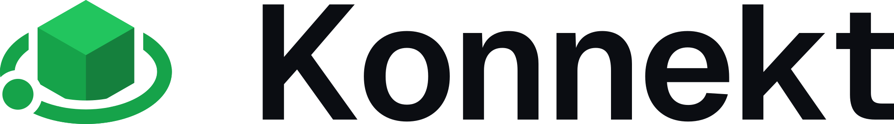
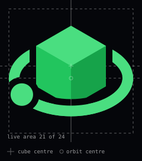
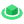

# Konnekt mark

The Konnekt mark is an isometric block, shaded in the three brand greens, with
one orbit around it and a node riding on the orbit: a server, and something
connected to it. It replaces the plain "K" that `build/appicon.png` carries
today. The app icon, favicon and website still use the "K"; switching them is
a separate change, described under [Rolling it out](#rolling-it-out).

<picture>
  <source media="(prefers-color-scheme: dark)" srcset="lockup-on-dark.svg">
  
</picture>

## Files

Every file is an SVG on a transparent background. The gaps between the orbit
and the block are real transparency (masks), not background-coloured strokes,
so each file works on any ground of its tone.

| File | Use |
| --- | --- |
| [`mark-on-dark.svg`](mark-on-dark.svg), [`mark-on-light.svg`](mark-on-light.svg) | The mark, above 24 px |
| [`mark-24-on-dark.svg`](mark-24-on-dark.svg), [`mark-24-on-light.svg`](mark-24-on-light.svg) | 17 to 24 px: heavier orbit, wider gaps, no node |
| [`mark-16-on-dark.svg`](mark-16-on-dark.svg), [`mark-16-on-light.svg`](mark-16-on-light.svg) | 16 px and below, drawn on a 16 grid |
| [`mark-mono-white.svg`](mark-mono-white.svg), [`mark-mono-black.svg`](mark-mono-black.svg) | One colour: the faces are separated by gaps instead of shade |
| [`lockup-on-dark.svg`](lockup-on-dark.svg), [`lockup-on-light.svg`](lockup-on-light.svg) | Mark and wordmark, the wordmark outlined |
| [`app-icon.svg`](app-icon.svg) | The mark at 80 % on a full-bleed `#05060a` square, the shape of `build/appicon.png` |
| [`construction.svg`](construction.svg) | The construction below |

## Construction

Drawn on a 24-unit grid. The mark fills a 21-unit live area, 1.5 units in from
every edge, and is centred on its own bounds.

| Part | Rule | Value in `mark-on-*.svg` |
| --- | --- | --- |
| Block | An isometric cube: a regular hexagon of radius *r*, split into three faces at its centre | *r* = 6.81 |
| Orbit | An isometric circle, so it lies in the same plane as the cube's top face: *ry* = *rx* × tan 30° = 0.577 *rx* | *rx* = 9.6 (1.41 *r*), *ry* = 5.54 |
| Orbit centre | On the cube's vertical axis, 0.3 *r* below the cube's centre | 2.05 below |
| Orbit stroke | Constant weight | 1.8 |
| Gap | Wherever the orbit passes the block or the node, in front or behind | 1.1 |
| Node | A circle on the front of the orbit, at 150° (front left) | radius 1.9 |

The orbit is level on purpose. A tilted orbit around an upright isometric block
always makes the block look off-centre, because the block's axis is then not
perpendicular to the orbit. Levelling it puts the block in the middle of its
orbit by construction.

## Sizes

Below 24 px the mark is redrawn, not shrunk. A 24-unit drawing shown at 16 px
loses a third of its size, and thin strokes and narrow gaps fall below a pixel
and blur ([Streamline on 16 px icons](https://design.streamlinehq.com/16x16-icons)).

| Cut | Use at | Changes |
| --- | --- | --- |
| Full | above 24 px | As constructed above |
| 24 | 17 to 24 px | Orbit 2.7, gap 1.5, no node |
| 16 | 16 px and below | Its own 16 grid, orbit 1.4, gap 0.9, no node; the block's three vertical edges sit on whole pixels (x = 3, 8 and 13), so it stays sharp in a tab |

    

## Colour

Only the suite's tokens, from `tokens.source.json`, plus one shade for light
grounds.

| Part | On dark | On light |
| --- | --- | --- |
| Top face | `#4ade80` (`accent`) | `#22c55e` |
| Left face | `#22c55e` (`success`, dark) | `#16a34a` |
| Right face | `#16a34a` (`success`, light) | `#15803d` |
| Orbit and node | `#4ade80` | `#16a34a` |
| Wordmark | `#ffffff` | `#0b0d12` |

On light grounds every face steps one shade darker, because `#4ade80` on
`#f5f6fa` is 1.6:1 and the top face disappears. `#15803d` is not a token yet;
it belongs in `kollektiv/design/tokens.json` before anything outside this folder
uses it, since `accent` has no light value today.

## Lockup

- The mark's box is 1.2 times the wordmark's font size, and its centre sits on
  the middle of the cap height.
- The gap between the box and the wordmark is 0.4 times the font size.
- The wordmark is Geist SemiBold at -0.03 em tracking, the face planned for the
  website redesign. The lockup files carry it as outlines, so they need no
  font installed. Geist is © Vercel under the SIL Open Font License 1.1.
- Clear space: at least half the mark's height on every side.
- Minimum sizes: the mark at 16 px with the 16 cut; the lockup at 96 px wide.
  Below that, use the mark alone.

## Do not

- Tilt the orbit, or lower it anywhere but along the cube's vertical axis.
- Scale a small cut up, or the full mark down past 24 px.
- Add outlines, shadows, gradients or glows, or recolour outside the table above.
- Put the coloured mark on a mid-tone ground. Use the app icon tile, or a mono file.

## Rolling it out

Not done yet. Each step is its own change.

1. **App icon.** Render `app-icon.svg` to a 2560 × 2560 PNG, replace
   `build/appicon.png` and its copy `website/assets/img/app-icon.png`, then run
   `go run ./scripts/gen-icons` and commit all four files, per
   [`build/README.md`](../../build/README.md). `docs/images/konnekt_icon.png`
   is the same image again.
2. **Favicon.** Replace `website/assets/img/favicon.png` from
   `mark-16-on-dark.svg` and `mark-on-dark.svg` (32 and 48 px).
3. **Website and app header.** Use the lockup in place of the text-only wordmark.
4. **Token.** Add the light-ground `#15803d` to kollektiv before step 3 needs it.
